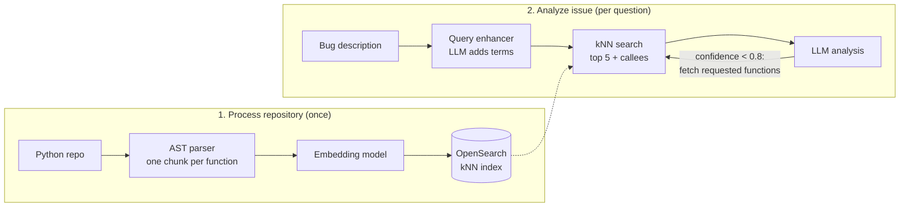

# Code Analysis Bot

Describe a bug in plain English and get back the functions most likely responsible, with `file:line` references, a confidence score and suggested fixes.

Code Analysis Bot indexes a Python repository function by function into OpenSearch, then answers questions about it with retrieval-augmented generation (RAG). It retrieves the functions that match your question, adds the functions they call, and asks an LLM to diagnose the problem from that code.

- Two retrieval approaches: **function lookup table** and **call graph**
- OpenAI, Ollama (local) or Perplexity as the LLM
- OpenAI or Ollama for embeddings (Perplexity optional, see [Configuration](#configuration))
- Interactive CLI and a Streamlit web UI
- Analysis history with statistics and JSON export

## How it works



1. **Parse.** Every function and method is extracted with Python's `ast` module, along with its file, line range, class, decorators, calls, imports and `try/except` blocks. Tests and virtualenvs are skipped by default.
2. **Link.** Calls are resolved to the functions they most likely target. `self.save()` resolves to `save` in the same class. A bare `helper()` resolves to the same module first, then to imported modules.
3. **Embed and store.** Each function is embedded and written to OpenSearch. Re-processing a repository replaces its earlier documents.
4. **Retrieve.** Your question is rewritten by an LLM into a better search query, embedded, and matched against the index with kNN search.
5. **Expand.** Each hit brings along the functions it calls, so the LLM sees code beyond the snippet that merely *looks like* the bug report.
6. **Generate.** The LLM returns an analysis with a confidence score. If confidence is below 0.8 and it names functions it still needs, those are fetched and the analysis runs again, up to 3 times.

## Analysis approaches

Both approaches use the same parser, query enhancer and analysis loop. They differ in what is embedded and how much surrounding code is gathered.

| | Function lookup table (default) | Call graph |
| --- | --- | --- |
| Embedding text | Name, file, module, class, decorators, calls and full code | Slimmer: name, module, class, main dependencies and key lines |
| Context added to each hit | Functions it calls directly | Callees up to a configurable depth (1-5), plus call paths from entry points |
| LLM prompt | Functions and their direct callees | Functions plus a call-graph summary; asks for graph insights |
| Extras | Export the function table as JSON or CSV | Graph statistics: nodes, edges, entry points, depth |
| Best for | Bugs inside one function or its direct callees | Bugs that cascade across several layers of calls |
| OpenSearch index | `code_embeddings` | `call_graph_embeddings` |

Each approach has its own index. After switching approach, process the repository again.

## Requirements

- Python 3.10+
- OpenSearch 2.x with the k-NN plugin (included in the official image), for both approaches
- One of:
  - an OpenAI API key, or
  - [Ollama](https://ollama.com) running locally with an embedding and a chat model pulled

## Quick start

**1. Start OpenSearch** (local development only: security is disabled).

```bash
docker run -d --name opensearch -p 9200:9200 \
  -e discovery.type=single-node \
  -e DISABLE_SECURITY_PLUGIN=true \
  -e DISABLE_INSTALL_DEMO_CONFIG=true \
  opensearchproject/opensearch:2.13.0
```

**2. Install.**

```bash
git clone https://github.com/RISHABH4SAHNI/Code_Analysis_Tool.git
cd Code_Analysis_Tool
python -m venv .venv && source .venv/bin/activate
pip install -r requirements.txt
cp .env.example .env    # then add your OPENAI_API_KEY
```

Using Ollama instead of OpenAI:

```bash
ollama pull nomic-embed-text
ollama pull codellama:7b
```

Then choose `ollama` for the embedding and LLM services when prompted.

**3. Run.**

```bash
python main_structured.py          # interactive CLI
streamlit run ui/streamlit_app.py  # web UI at http://localhost:8501
```

In the CLI, choose **1. Process Repository** and enter a path, then choose **2. Analyze Issue** and describe the problem. In the web UI, click **Initialize Services** in the sidebar, process a repository on the first tab, then ask a question on the second tab.

## Using it from Python

```python
from dotenv import load_dotenv
from core.workflow_engine import WorkflowEngine

load_dotenv()
engine = WorkflowEngine(
    embedding_service_type="openai",   # or "ollama"
    llm_service_type="openai",         # or "ollama", "perplexity"
    analysis_approach="call_graph",    # or "function_lookup_table"
)

stats = engine.process_repository("/path/to/repo")
print(stats["total_functions"], stats["embedded_functions"])

result = engine.analyze_user_issue(
    "Login fails with a 500 error when the password is empty",
    context={"repo_name": "my-app", "priority": "high", "call_graph_depth": 3},
)
print(result["confidence_score"])
print(result["analysis"])
for fix in result["suggested_fixes"]:
    print("-", fix["description"])
```

Other useful calls:

- `engine.switch_analysis_approach(name)`: returns `True` if the repository needs processing again.
- `engine.set_llm_service(name)`: switches the LLM without re-indexing.
- `engine.export_function_lookup_table(path, "csv" or "json")`: lookup table approach only.
- `engine.get_recent_analyses(10)` and `engine.get_analysis_history_stats()`.

## Configuration

Settings are read from environment variables, or from a `.env` file in the project root.

| Variable | Default | Purpose |
| --- | --- | --- |
| `OPENAI_API_KEY` | | Required for OpenAI embeddings or LLM |
| `OPENAI_CHAT_MODEL` | `gpt-4o` | Model for query enhancement and analysis |
| `OPENAI_EMBEDDING_MODEL` | `text-embedding-3-large` | Embedding model |
| `OPENAI_EMBEDDING_DIMENSIONS` | `3072` | Must match the embedding model |
| `OLLAMA_BASE_URL` | `http://localhost:11434` | Ollama server |
| `OLLAMA_CHAT_MODEL` | `codellama:7b` | Ollama chat model |
| `OLLAMA_EMBEDDING_MODEL` | `nomic-embed-text` | Ollama embedding model |
| `OLLAMA_EMBEDDING_DIMENSIONS` | `768` | Must match the embedding model |
| `PERPLEXITY_API_KEY` | | Required for Perplexity |
| `PERPLEXITY_CHAT_MODEL` | `sonar` | Perplexity chat model |
| `PERPLEXITY_EMBEDDING_MODEL` | | Must be set to use Perplexity for embeddings |
| `PERPLEXITY_EMBEDDING_DIMENSIONS` | `1024` | Must match that model |
| `OPENSEARCH_HOST` / `OPENSEARCH_PORT` | `localhost` / `9200` | OpenSearch address |
| `OPENSEARCH_USER` / `OPENSEARCH_PASSWORD` | `admin` / `admin` | OpenSearch credentials |
| `OPENSEARCH_USE_SSL` / `OPENSEARCH_VERIFY_CERTS` | `false` / `false` | TLS settings |

If you change the embedding model or dimensions, the index is recreated automatically the next time you process a repository.

Tuning constants such as the confidence threshold (`0.8`), the number of re-analysis rounds (`3`), results per search (`5`) and skipped directories live in [config/settings.py](config/settings.py).

## Project structure

```
main_structured.py            CLI entry point
ui/                           Streamlit app and display components
core/
  workflow_engine.py          Orchestrates processing and analysis
  repository_processor.py     AST extraction of functions and metadata
  call_resolver.py            Maps calls to the functions they target
  call_graph_processor.py     Builds and walks the call graph
  function_lookup.py          Tabular function index with JSON/CSV export
services/
  embedding_service.py        OpenAI / Ollama / Perplexity embeddings
  opensearch_base.py          Shared OpenSearch client and index management
  vector_search_service.py    Lookup table approach search
  call_graph_search_service.py  Call graph approach search
  query_enhancement_service.py  LLM query rewriting
  analysis_service.py         Prompting and response parsing
factories/                    Builds the services for a chosen approach and provider
models/                       Dataclasses for functions, search results and the graph
utils/                        File discovery helpers and analysis history
tests/                        pytest suite
```

## Development

```bash
pip install -r requirements-dev.txt
pytest
```

The tests mock every external service, so they need neither API keys nor OpenSearch.

## Limitations

- Only Python is analysed.
- Call resolution is static and best-effort. Calls on arbitrary objects (`client.get()`) link to every function with that name, and dynamic dispatch is not followed.
- The call graph is held in memory for the session that built it. The CLI and UI process a repository before analysing, so this matters only when using `WorkflowEngine` directly across restarts.
- Confidence scores are the LLM's own estimate, not a measured accuracy.

## License

[MIT](LICENSE)
